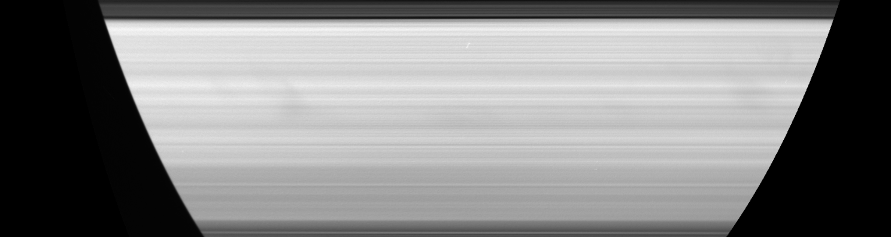
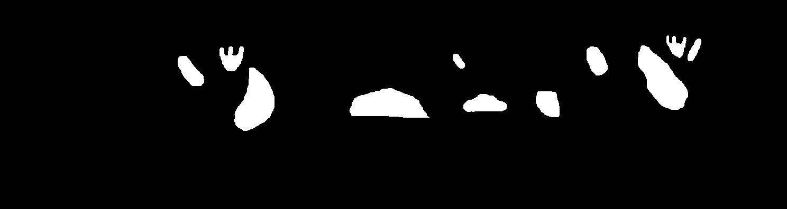
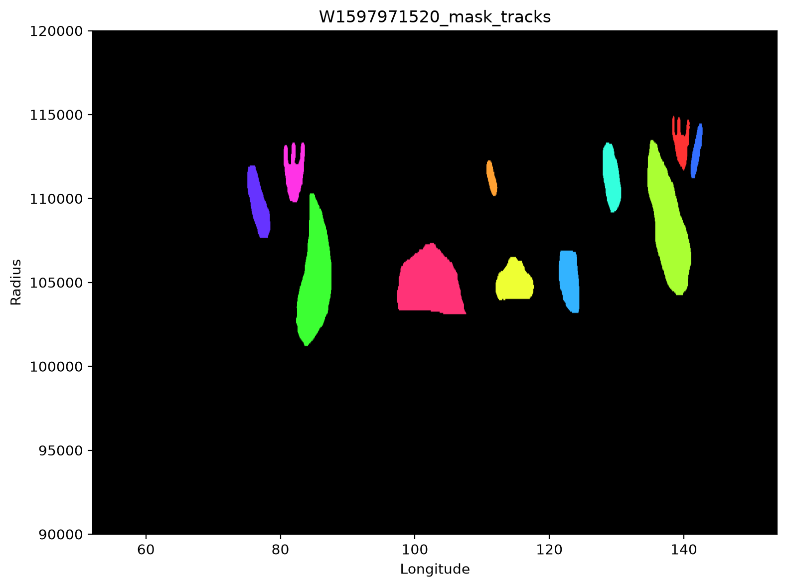
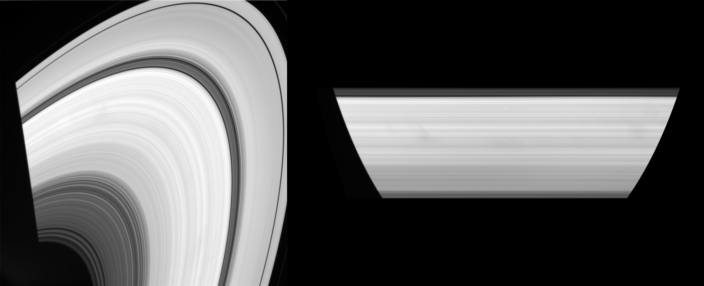
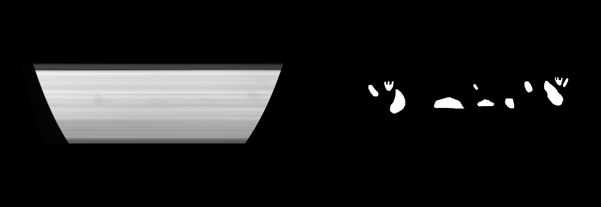
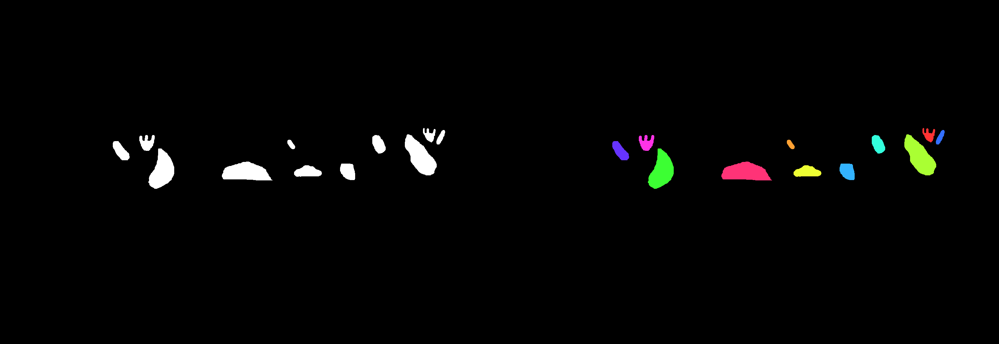

# Spokes Tracking

## TL;DR

This is a code that tracks spokes that have been segmented in a binary segmentation mask.

## Table of Contents

- [Introduction](#introduction)
- [The Data](#the-data)
- [How It Works](#how-it-works)
  - [Motion Model](#motion-model)
  - [Cost Function](#cost-function)
  - [Matching Function](#matching-function)
  - [Edge Cases](#edge-cases)
- [Results](#results)
- [Future Ideas](#future-ideas)
- [References](#references)

## Introduction
Spokes are dust clouds over the rings of Saturn. They have been observed several times, and are a very interesting phenomena. For this project, we are concerned with mainly the B-ring of Saturn, and here we observe several kinds of spokes- dark against a light background, light against a dark background, mixed, and more[^1]. For our project, we are concerned with analyzing these spokes to determine certain valuable patterns and interesting statistics. In order to accomplish this, I envision our pipeline looking as follows:
<br>
```text
  Raw Images --> Segmentation Model --> Tracking Algorithm --> Statistics
```
<br>

<p align="center">
  
  <br>
  <em>Figure 1: Image of Saturn's B-ring in polar-coordinates.</em>
</p>

<p align="center">
  
  <br>
  <em>Figure 2: Hand labelled mask of Figure 1.</em>
</p>

<p align="center">
  
  <br>
  <em>Figure 3: Tracked spokes in Figure 2 with axes.</em>
</p>


This project deals with the tracking algorithm part of this pipeline- given a binary segmented mask of spokes, can we track these spokes across images?

The code is modular and breaks the problem down into subcomponents. All of the code can be found in [./code](./code).

## The Data

We are working with images of the B-ring of Saturn that have been taken by the Cassini spacecraft. These images can be obtained using the [**OPUS (Outer Planets Unified Search)**](https://opus.pds-rings.seti.org/opus/?utm_source=chatgpt.com#/cols=opusid,instrument,planet,target,time1,observationduration&widgets=instrument,observationtype,target&order=time1,opusid&view=search&browse=gallery&cart_browse=gallery&startobs=1&cart_startobs=1&detail=) tool maintained by NASA's Planetary Data System Ring-Moon Systems Node.

These images are taken by the spacecraft at an angle, and it is not the best way to see spokes in these. So, in order to be able to work with these images better, we re-project them into polar-coordinates.
<br><br>
<p align="center">
  
  <br>
  <em>Figure 4: Saturn's B-ring observed by Cassini vs the same image in polar coordinates.</em>
</p>

Once we have re-projected these images, we obtain binary masks from them, where all spokes are labelled 1 and all non-spokes are labelled 0. To test tracking, I hand labelled a few images that were taken contiguously in time, but in practice, we would be training binary segmentation model to detect spokes, and then feed individual images into our tracking algorithm.
<br><br>
<p align="center">
  
  <br>
  <em>Figure 5: Re-projected images vs hand-labelled segmentation masks.</em>
</p>

The input to the tracking algorithm is the masks, and it does not deal with the original image or with the re-projected image. 

## How It Works

### Motion Model

Given a *frame*, we predict the position of all spokes in that frame for the next frame. For this, we assume that spokes follow a simple Keplerian motion model. This model can be described as follows:
```math
\begin{aligned}
  \theta_{k+1} &= \theta_k + \omega_r \Delta t \\
  \text{where } \omega &= \sqrt{{GM} \over r^3}
\end{aligned}
```
So, for every longitude and radius coordinate of a spoke, we calculate the new longitude value based on the angular velocity for that radius value, and the given time difference. <br>
For every such prediction, we propagate the track id from the previous mask, and then we "superimpose" this prediction on the new observation. 

### Cost Function

The way this works is that we have a cost metric, and for every spoke pair between the predicted frame and the observed frame, we calculate this cost as such:
```math
\begin{aligned}
  c &= {d(s_1, s_2) \over {ds}} - (10 i(s_1, s_2))^2 \\
  \text{where } ds &= 20,000
\end{aligned}
```
$d(s_1, s_2)$ gets the distance between spokes $s_1$ and $s_2$ by calculating a simple distance between the centroids of those spokes, and $i(s_1, s_2)$ calculates the Intersection Over Union (IoU) score for both spokes. $ds$ stands for distance scale, and is a way to make distance a unit-less quantity so that it can be used for the cost function. We arbitrarily choose $ds$ to be 20,000.

### Matching Function

To propagate ids between the predicted frame and the observed frame, we use a brute force, greedy approach and compare every possible pair of spokes between the two frames. We calculate the cost for each comparison, and say that the spokes that have the least cost must be the same spoke, and we assign track ids accordingly. <br>
For each track id, we assign a unique color so that we can visualize the spokes being tracked.

### Edge Cases

1. **New spoke enters the frame**:
We assume that a new spoke that enters the frame will invariably have among the least costs out of all the combinations. So, it is relatively easy to identify these, and assign them a new tracker id.

2. **A spoke exits the frame**:
This case is trivial because there is no matching that occus for such spokes- their longitude value is off the axis and so there is no comparison to be made. We do nothing here.

3. **A spoke disappears**:
This is a non-trivial case, mainly because the reason that a spoke disappears from a frame could be that it actually disappears in real-life, or that it is a marking error. The current pipeline does not explicitly handle this case. Based on the cost values, we end up losing the 'disappeared' spoke.

## Results

I tested this code incrementally on a single folder containing re-projected images taken contiguously in time.
<br><br>
<p align="center">
  
  <br>
  <em>Figure 6: Hand-labelled segmentation masks vs tracks.</em>
</p>

The code seems to do really well with this one folder, and tracks every spoke perfectly across different masks.

## Future Ideas

In the future, I have a few ideas with this project:
- Test the code on different folders to check robustness
- Wrap an Agent around the output to make research easier and more efficient.

## References

[^1]: Callos, S. R., Hedman, M. M., & Hamilton, D. P. (2025). *A survey of Cassini images of spokes in Saturn’s rings: Unusual spoke types and seasonal trends.*
